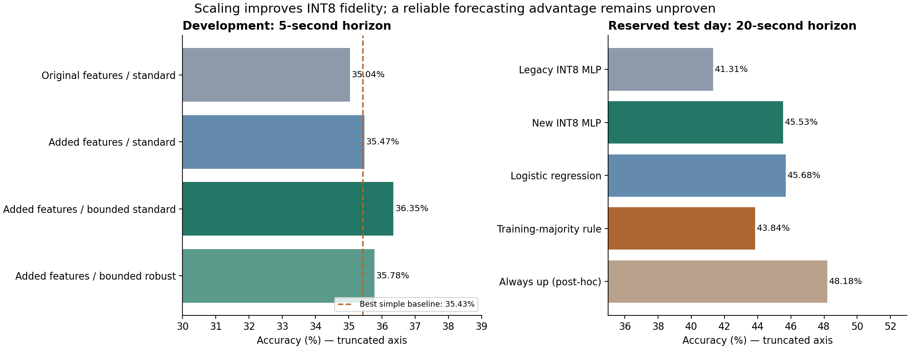

# Prediction-quality development on macOS

Training, feature diagnostics, quantization, source replay, and Icarus RTL
simulation run on macOS with the pinned `requirements-training.txt` packages.
No CUDA, GPU, FPGA board, or Vivado is required for these experiments.

## Recorded result

The selected export is **102→16→3**, a 20-second horizon, unweighted training,
`alpha=1`, robust scaling bounded at +/-4, and no stationary-logit offset. The
study fitted 45 models and scored 105 variants including bias adjustments.
All neural-network fits completed without convergence warnings. Selection was
frozen before opening the 2019-12-30 test examples.

On the **same 23,377 twenty-second test examples**:

| Model or rule | Accuracy | Macro-F1 |
| --- | ---: | ---: |
| New INT8 MLP | 45.53% | 0.3054 |
| Legacy 8-neuron MLP, retrained on these training days | 41.31% | 0.2665 |
| Selected logistic regression | 45.68% | 0.3156 |
| Selected gradient-boosted trees | 45.57% | 0.3153 |
| Training-majority rule (always down) | 43.84% | 0.2032 |
| Always stationary | 7.98% | 0.0493 |

The MLP gains **4.22 percentage points over the matched legacy model** and
**1.69 points over the training-majority rule**. The latter's paired 60-second
block-bootstrap 95% interval is **-0.13 to +3.46 points**, including zero.
The selected MLP's stationary recall is zero; down/up recall is 70.77%/30.10%.
This is a better model than the legacy export on this sample, but a useful
forecasting advantage has **not** been established.

An additional **post-hoc diagnostic**, not used to select or retune models, shows
that always predicting up would achieve **48.18%** on this test day. This exceeds
the selected model and reinforces the limitation. A future development study
should include all constant-direction rules before reserving fresh test days.
The current test day must not be reused to select another model.

At the original five-second horizon, the separately frozen MLP scores **39.20%**,
versus 19.29% stationary and **42.50%** for its development-selected majority
rule (always up). Its loss to that stronger baseline is 3.30 points, with a
block interval of -5.34 to -1.24. Beating stationary alone is insufficient.

### What helped during development

These are matched **five-second validation** comparisons, with no stationary
bias adjustment:

| 16-neuron, unweighted model | INT8 accuracy | Float accuracy | Input step |
| --- | ---: | ---: | ---: |
| Existing features, standard scaling | 35.04% | 36.09% | 2 |
| Added causal features, standard scaling | 35.47% | 36.36% | 2 |
| Added features, standard scaling bounded at +/-4 | 36.35% | 36.40% | 0.0625 |
| Added features, robust scaling bounded at +/-4 | 35.78% | 35.86% | 0.0625 |

Unbounded training outliers forced a coarse per-layer INT8 input scale, losing
useful distinctions even with no validation saturation. Bounded standard scaling
clipped 0.63% of validation feature values and substantially reduced this
quantization penalty. Robust scaling helped the selected twenty-second model,
but was not superior at every horizon. Larger networks and class balancing did
not consistently improve accuracy. At one second, the best MLP essentially tied
stationary (63.75% versus 63.73%), with macro-F1 only 0.2611.

For the selected twenty-second export, INT8 saturation is **0%** on train,
validation, and test inputs. Intentional preprocessing clipping is **2.20%,
1.62%, and 5.47%**, respectively. The higher test clipping rate still indicates
distribution shift; zero integer saturation does not mean no information was
discarded. Float test accuracy is 45.52%, within 0.01 points of the INT8 result.



### Verification and artifacts

- **74 Python tests** and **15 RTL regression tests** pass.
- All **23,377** test predictions and integer intermediates match independent
  scalar evaluation and replay from the original CSV, including normalization,
  labels, and day splits.
- **256/23,377** evenly spaced test vectors match saved ROMs through both RTL
  layers and the connected 4×3-lane MLP, with and without stalls. This is sampled
  RTL coverage, not a claim of simulating the entire test day.
- The new weights, preprocessing, and vectors are in `build/prediction-quality/`.

Saved artifacts: [protocol](../results/prediction-quality/protocol.json),
[all development scores](../results/prediction-quality/selection.json),
[final results](../results/prediction-quality/report.json),
[interpretation](../results/prediction-quality/findings.json),
[source replay](../results/prediction-quality/replay_report.json), and
[sampled RTL verification](../results/prediction-quality/rtl_report_4x3_sampled256.json).

## Clipping investigation

The frozen synthetic model saturates 47.61% of INT8 input values on the earlier
982-example Nasdaq premarket sample. Deep bid/ask price-distance features are
especially far outside its training distribution. On the two complete regular
trading days used for training (2019-07-30 and 2019-08-30), the same unchanged
model saturates approximately 0.09% of input values. These are different market
sessions and sampling schemes, not a paired model improvement. Merely enlarging
the quantization range cannot establish useful predictions on sparse premarket
books. Per-feature measurements are in
[the clipping investigation](../results/prediction-quality/clipping-investigation.json).

## Fixed development protocol

Use the [complete-day dataset](full-day-data.md): July 30 and August 30 train,
October 18 validates, and December 30 is reserved for a separate final evaluation.
All dates are in 2019 and were chosen before scoring. Labels and feature windows
stay within sessions; normalization and integer scale calibration use training
days only. There is no refit on validation data.

The predeclared study compares:

- Endpoint midpoint movement at 1, 5, and 20 seconds, stationary within half a tick.
- Existing features against causal midpoint changes, best-queue imbalance,
  microprice displacement, and normalized best-quote flow between snapshots.
  Sampled flow cannot recover all individual order events between grid points.
- Standard scaling, standard scaling bounded to +/-4, and median/IQR scaling
  bounded to +/-4. A degenerate IQR falls back to training standard deviation.
- Unweighted and class-balanced training, 8/16/32 hidden neurons, selected L2
  strengths, and stationary-logit offsets 0/0.25/0.5. Offsets are folded into
  existing output biases, requiring no new RTL operation.
- Logistic regression and histogram gradient boosting as CPU comparators.

Selection maximizes validation accuracy **above the strongest simple baseline at
that same horizon** (always stationary, training-majority class, or last-move
persistence), then macro-F1; declared candidate order resolves exact ties.
Raw accuracies at different horizons are not directly comparable. MLP selection
uses INT8 inference, with floating-point scores also recorded. Every candidate's
scores, iterations, and convergence warnings are saved.

Intentional preprocessing clipping and INT8 saturation are reported separately:
bounded inputs discard tail magnitude even when quantization saturation is zero.
The choice must earn its place through development performance. The scaling
comparison is motivated by the documented sensitivity of standard scaling to
outliers; robust scaling is not assumed to be superior.
[scikit-learn preprocessing documentation](https://github.com/scikit-learn/scikit-learn/blob/main/doc/modules/preprocessing.rst).

## Reproduce

```sh
python3 -m scripts.prepare_itch_days
python3 -m models.training.train_days --phase develop --synthetic-model build/lob-improved/model
python3 -m models.training.train_days --phase evaluate
python3 -m scripts.verify_lob_replay --model build/prediction-quality --input build/nasdaq-days/snapshots.csv
python3 -m scripts.verify_export --model build/prediction-quality --hidden-lanes 4 --output-lanes 3 --sample-count 256
```

Development writes the protocol before fitting, then freezes the selected models
and checksums before any final-test examples are scored. The separate evaluation
phase rejects changes to frozen artifacts and refuses to overwrite an existing
final report. Use a fresh output path for a deliberately new development study;
once examined, the old test day is no longer fresh evidence for further tuning.

The final report compares selected families at their respective horizons,
includes the legacy MLP at the selected MLP horizon, and separately reports the
best five-second MLP. Paired 60-second block bootstrap intervals describe
within-day accuracy differences; they do not establish performance across unseen
days. Four nonconsecutive days of one symbol are a limited experiment.

Exports retain full test vectors and verify every integer intermediate against
the scalar reference. The RTL command above explicitly samples 256 evenly spaced
test examples, including both endpoints, and checks each with and without stalls;
its report records partial coverage. Omitting `--sample-count` retains the existing
full-export verification behavior, which can exceed simulation time limits on
large datasets. The selected CPU comparators and their own preprocessing
are in the local `frozen.joblib` artifact; only the selected MLP is an RTL export.
Raw data, trained model binaries, and large vectors remain under ignored `build/`.
